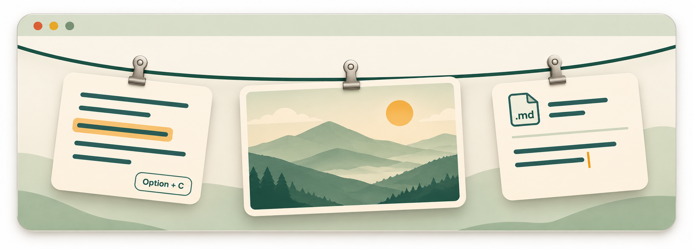

<p align="center"></p>

<h1 align="center">Catch what you see</h1>

<p align="center">Based on <a href="https://github.com/alejandrobujan/tendedero">Tendedero</a>, adding text collection and Markdown notes.</p>

<p align="center"><a href="../../README.md">中文版</a> · <strong>English</strong></p>

<p align="center"></p>

Tendedero hangs screenshots on a clothesline at the top of the screen. I liked that idea and wanted to put selected passages there too. This version keeps the original screenshot interaction and lets text notes hang beside the images.

[Download](https://github.com/RichardPotter-Lai/catch-what-you-see-public/releases/latest) · [Install](../INSTALL.md)

## Use it

Select text, then press and release **Option+C**. Catch saves a local Markdown note and hangs a preview on the clothesline. Move the pointer to the middle of the menu bar, or press **Control+Option+T**, to bring it down. Click a text note to copy its excerpt; double-click to open the MD file.

Screenshots use the usual macOS shortcuts. They stay temporary until you choose to collect them. Hiding a card or filling the line does not delete its file.

Some apps allow copying without exposing an Accessibility selection. An optional fallback runs one Copy command after you request collection, reads the new text, and tries to restore the previous clipboard. You can disable it, or copy text yourself and choose the explicit clipboard collection command.

## What changed from Tendedero

The screenshot clothesline, clips and original animation interaction come from Tendedero. This version mainly adds text capture, text cards, Markdown storage, and a local library for search, preview and external editing. Text and images share the deletion/recovery flow.

Each intentional collection creates a separate `.md`; images use relative attachment paths. The default library is:

```text
~/Library/Application Support/CatchWhatYouSee/Library/
```

Edit it with your usual Markdown tools. Back up the entire library, including hidden folders. There is no built-in account, content upload, analytics service or passive clipboard history. Clipboard restoration is best effort; known newer copies are kept. See [privacy](../PRIVACY.md).

## Install

On macOS 14+, the easiest way is one line in Terminal (no Homebrew or Swift needed):

```sh
curl -fsSL https://raw.githubusercontent.com/RichardPotter-Lai/catch-what-you-see-public/main/scripts/install-macos.sh | bash
```

It downloads the latest release, checks SHA-256 and the code signature, installs to `/Applications` (or `~/Applications` when that is not writable) and opens the app. Installed this way, macOS does **not** show the "cannot verify the developer" block. To upgrade an existing copy, append `-s -- --upgrade` after `bash`.

You can also download the universal DMG from [Releases](https://github.com/RichardPotter-Lai/catch-what-you-see-public/releases/latest) and drag the app to Applications. The build is not notarized yet, so a browser download is blocked on first open; see [installation and updates](../INSTALL.md#首次打开被拦截) for the fix. On first launch the app shows where its menu bar icon is and walks you through granting Accessibility access, which Option+C needs.

## Ask a local agent

Give this to Codex desktop, Claude Code, or WorkBuddy with access to your Mac's terminal and files:

<details>
<summary>Open and copy the installation request</summary>

```text
Install and open Catch what you see on this Mac:
https://github.com/RichardPotter-Lai/catch-what-you-see-public

Check macOS 14+, then run in Terminal:
curl -fsSL https://raw.githubusercontent.com/RichardPotter-Lai/catch-what-you-see-public/main/scripts/install-macos.sh | bash
If it reports an existing installation, confirm with me, then rerun with `| bash -s -- --upgrade` (my library is kept).
Keep Gatekeeper enabled and use normal system permission prompts; do not edit permission databases or upload private content.
Open the installed app and explain Option+C. Tell me which system confirmations require my input. Report only installation and launch steps you actually completed.
```

</details>

Codex Cloud normally runs in a cloud environment. Installing this app needs execution on the target Mac. Without that access, ask the agent to inspect the repository and prepare commands for a local agent; cloning the source in a cloud workspace does not install a macOS app on your computer. See [OpenAI's cloud environment documentation](https://learn.chatgpt.com/docs/environments/cloud-environments).

## Requirements and limits

The build target is macOS 14+. Universal packages contain arm64 and x86_64, but Intel and older systems have not received full device testing. WeChat and commonly used web pages were manually tested on an Apple silicon Mac; this is not a claim that every app or PDF view works. There is no OCR. See [compatibility](../COMPATIBILITY.md).

The current UI is in Simplified Chinese. Builds are ad hoc signed, not Apple notarized. Follow the normal opening and Accessibility authorization steps in [INSTALL](../INSTALL.md).

## Build

On a Mac with the Swift toolchain:

```sh
git clone https://github.com/RichardPotter-Lai/catch-what-you-see-public.git
cd catch-what-you-see-public/app
swift run CaptureCoreChecks
swift build -c debug
bash scripts/build-app.sh debug
```

Use an isolated development library. See [development](../DEVELOPMENT.md) and [contributing](../../CONTRIBUTING.md).

## Attribution and license

Based on Tendedero 1.8.1 by Alejandro Buján. Thank you for creating and sharing the original project.

Code is [MIT licensed](../../LICENSE), retaining upstream notices. Catch uses a different name and an independently drawn icon. Upstream branding and promotional artwork are not included in this public source snapshot or relicensed here. See [third-party notices](../../THIRD_PARTY_NOTICES.md).
